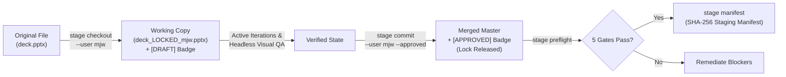

# Enterprise Workbench CLI (`bench`) — Architectural Reference & Command Catalog

> **Canonical CLI Documentation for `enterprise-bench`**  
> Unified CLI for Presentations (`ppt`), Compliance Documents (`doc`), Spreadsheets (`xlsx`), Diagrams (`diagram` & `diagram v2`), Assets (`asset`), PII Sanitization (`pii`), Localization (`locale`), Change Requests (`cr`), and Delivery Staging (`stage`).

---

## 🏛 Architecture & Execution Philosophy

The `bench` CLI is structured as a high-performance, modular command line suite built on [Typer](https://typer.tiangolo.com/) and [Rich](https://rich.readthedocs.io/). All commands execute in project virtual environments (`uv run bench ...`).

```
                              ┌─────────────────────────────┐
                              │     bench (Root Router)     │
                              └──────────────┬──────────────┘
                                             │
      ┌───────────┬───────────┬──────────────┼─────────────┬───────────┬───────────┐
      ▼           ▼           ▼              ▼             ▼           ▼           ▼
   [ ppt ]     [ doc ]     [ xlsx ]     [ diagram ]    [ asset ]    [ pii ]    [ stage ]
      │           │           │              │             │                       │
      │           │           │              ▼             │                       ▼
      │           │           │        [ diagram v2 ]      │                  Preflight
Presentation Compliance Spreadsheets   Declarative YAML  Deterministic       Concurrency
   Engine      Engine      Engine        Compilers      Asset Resolver      & Manifests
```

### 🏎 Fast Headless Startup (Zero-Docxtpl Eager Import)
Heavy dependencies such as `docxtpl` and `python-docx` compiler components are imported lazily inside specific command handlers. Root commands and inspection routines execute with near-instantaneous startup latencies (<100ms).

### 🖥 Headless Verification & Window Control Invariant
In accordance with consulting collaboration standards:
- **Default Headless Verification:** Automated visual checks, DrawingML collision lints, and preflight verifications run headlessly.
- **Explicit Window Pop Only:** Native desktop applications (`Microsoft PowerPoint`, `Microsoft Word`, `Preview`) are launched **only** when passed explicit flags (`--open`) or upon direct user invocation (`"pop it"`, `"show me"`).

---

## ⚡ The 3-Lane Execution Model

All deliverables authoring and remediation activities follow the standardized 3-Lane Execution Model:

| Execution Lane | Focus & Scope | Modifies Shape Coordinates? | Standard CLI Invocations |
| :--- | :--- | :--- | :--- |
| **Lane 1: Inspection & Audit** | Read-only verification, headless geometric linting, stage-gate health checks. | ❌ Strictly No | `bench diagram v2 audit`<br>`bench stage preflight`<br>`bench pii audit`<br>`bench ppt visual-qa`<br>`bench doc check-aspect` |
| **Lane 2: In-Situ Micro-Patch** | Localized text fixes, typo repairs, label corrections, or direct image asset substitutions in existing decks. | ❌ No | `bench ppt replace-image`<br>`bench doc sanitize`<br>`gslides update-text` |
| **Lane 3: Greenfield Architecture** | Authoring or refactoring declarative YAML specifications, compiling to 4 formats, collaborative staging. | ✅ Yes (via compiler) | `bench diagram v2 compile`<br>`bench stage checkout`<br>`bench stage commit`<br>`bench stage manifest` |

---

## 📦 Staging & Handover Workflow (`bench stage`)

The `bench stage` sub-app implements atomic concurrency control and preflight gatekeeping for multi-collaborator handovers (e.g. pushing deliverables to shared cloud drives).



### 1. Concurrency Locking (`checkout` & `commit`)
- **`bench stage checkout <file> --user <user> [--reason <msg>]`**:
  Atomically acquires a lock, writes a `<file>.lock` sidecar, generates a working copy `<stem>_LOCKED_<user>.<ext>`, and stamps a non-blocking `[DRAFT]` status badge on presentation slides.
- **`bench stage commit <file> --user <user> [--approved] [--force]`**:
  Validates working copy integrity, updates overlay badge to `[APPROVED]` (or strips it clean if unapproved), merges the working copy into master, and cleans up the lock sidecar.

### 2. Status & Preflight Gates (`status` & `preflight`)
- **`bench stage status [directory]`**:
  Displays active collaborative locks across the directory tree in a Rich table.
- **`bench stage preflight [directory] [--strict]`**:
  Executes 5 automated gatekeeper checks:
  1. `DIRECTORY_ACCESSIBILITY`: Directory exists and is readable.
  2. `DELIVERABLE_INVENTORY`: Contains candidate delivery files.
  3. `LOCK_CONCURRENCY_AUDIT`: Zero active locks or orphaned `_LOCKED_` working copies.
  4. `ZERO_BYTE_CORRUPTION_GUARD`: No truncated 0-byte corrupted files.
  5. `PRESENTATION_OVERLAY_INSPECTION`: Audits status badges across `.pptx` decks.

### 3. Cryptographic Manifest (`manifest`)
- **`bench stage manifest [directory] [--target-root <name>] [--output <path>]`**:
  Validates preflight gates and compiles a cryptographically signed SHA-256 `delivery_manifest.json` cataloging every file, size, modified timestamp, and overlay badge.

---

## 🛠 Complete Command Reference (54 Commands)

### 1. Root Commands

```bash
# Provision an enterprise project scaffold inside output/<project_name>
uv run bench init-project <ProjectName> [--client <name>] [--vendor <name>]

# Browse and search enterprise deliverable templates across project phases
uv run bench catalog [--phase <phase>] [--query <substring>]

# Run fast unit tests (<1s) or full integration verification suites
uv run bench test [--unit] [--integration] [--marker <tag>] [--all]
```

---

### 2. Presentation Engine (`bench ppt`)

```bash
# List all registered enterprise themes and primary brand colors
uv run bench ppt themes

# Generate an executive consulting deck using standard archetypes (BCG 3-Horizon, Scorecard)
uv run bench ppt generate [--theme <name>] [--output <path.pptx>] [--title <title>]

# Build a full multi-slide presentation from a declarative YAML configuration
uv run bench ppt build-deck --config <deck.yaml> [--output <path.pptx>] [--theme <name>] [--open]

# Substitute images in a PowerPoint deck while preserving container aspect ratios
uv run bench ppt replace-image --input <deck.pptx> --new-image  [--slide <num>] [--fit]

# Verify and audit presentation image resources and typography fallbacks
uv run bench ppt check-resources [--download] [--clean] [--strict]

# Frame raw software UI screenshots inside a high-DPI desktop browser chrome mockup
uv run bench ppt frame-mockup [--input <screen.png>] [--url <url>] [--theme light|dark] [--dpi 300]

# Export presentation slides to high-DPI preview PNG images
uv run bench ppt export-preview --pptx <deck.pptx> [--output <dir>] [--dpi 150] [--open]

# Run automated DrawingML spatial collision and text overflow linter on PPTX slides
uv run bench ppt visual-qa [--file <deck.pptx>] [--capture-live] [--output-dir <dir>]
```

---

### 3. Document Compliance Engine (`bench doc`)

```bash
# Stamp a Word template with JSON data payload and execute automated QA linter
uv run bench doc stamp --template <name.docx> [--data <payload.json>] [--output <out.docx>]

# Compile modular Markdown specification files into an audit-ready Word document (.docx)
uv run bench doc compile-spec --input <spec.md|dir> [--output <out.docx>] [--theme <name>]

# Scrub sensitive client/vendor PII from a .docx file and inject Jinja2 placeholder tags
uv run bench doc sanitize --input <raw.docx> [--output <clean.docx>]

# Purge comments, text highlights, and tracked revisions from OpenXML Word documents
uv run bench doc purge --file <path.docx> [--dir <dir>] [--comments] [--highlights] [--revisions]

# Audit embedded drawings in a .docx document for aspect ratio squish and optical distortion
uv run bench doc check-aspect --file <path.docx> [--tolerance 3.0]

# Automatically correct squished or distorted image bounding boxes in a .docx file
uv run bench doc fix-aspect --file <path.docx> [--output <out.docx>] [--max-width 6.5]

# Perform automated linting on a Word document (checks unrendered Jinja tags, missing tables)
uv run bench doc lint --file <path.docx>

# List available document and governance templates across project phases
uv run bench doc list-templates [--phase <phase>] [--query <substring>]
```

---

### 4. Spreadsheet & Financial Engine (`bench xlsx`)

```bash
# Inject calculations or cell updates into an Excel spreadsheet template
uv run bench xlsx calculate --template <template.xlsx> [--data <payload.json>] [--output <out.xlsx>]

# Generate a project S-curve cumulative progression sheet with openpyxl LineChart
uv run bench xlsx s-curve [--weeks 12] [--distribution sigmoid] [--output <out.xlsx>]

# Safely append a risk event into the project Risk Register spreadsheet
uv run bench xlsx append-risk --title <title> --desc <desc> --impact <statement> --category Scope

# Safely append a blocker or issue into the project Issue Log spreadsheet
uv run bench xlsx append-issue --title <title> --desc <desc> --category Technical --owner <pic>

# Safely append a bug or QA failure into the project Defect Tracker spreadsheet
uv run bench xlsx append-defect --summary <title> --desc <desc> --module <mod> --pic <name>

# Append an executive or operational stakeholder into the Stakeholders Register
uv run bench xlsx append-stakeholder --name <name> --email <email> --role <role> --company <org>

# Calculate cloud infrastructure sizing and stamp Cloud Sizing Calculator workbook
uv run bench xlsx cloud-sizing [--client <name>] [--storage <TB>] [--cortex <USD>] [--fx 16500]

# Extract progression from timeline workbook and inject executive S-curve line chart tab
uv run bench xlsx sync-s-curve [--timeline <timeline.xlsx>] [--output <out.xlsx>] [--chunk-days 7]

# Update deliverable sign-off status in the Project Closeout Checklist spreadsheet
uv run bench xlsx update-closeout --item <name> --status Delivered|Done|Yes
```

---

### 5. Multi-Page Diagram Engine (`bench diagram`)

```bash
# List all diagram tabs/pages in a multi-page Draw.io project file
uv run bench diagram list <project.drawio>

# Add or update a diagram page from Mermaid flowchart syntax
uv run bench diagram add <project.drawio> --page <tab_name> --mermaid "graph TD; A-->B"

# Export a specific diagram page to high-DPI PNG or vector SVG
uv run bench diagram export <project.drawio> --page <tab_name> --output <plate.png> [--scale 3.0]

# Export all diagram pages from a Draw.io file to a destination folder
uv run bench diagram export-all <project.drawio> --output-dir output/diagrams/ [--format png|svg]

# Build a multi-page Draw.io project from a declarative YAML manifest
uv run bench diagram build-project --config <diagrams.yaml> [--output <project.drawio>]

# Delete a specific page or tab from a multi-page Draw.io file
uv run bench diagram delete <project.drawio> --page <tab_name>

# Compile architecture diagrams into 100% native, editable PowerPoint DrawingML slides
uv run bench diagram export-pptx [--output <deck.pptx>] [--open]

# Import an external Draw.io <mxlibrary> package and register extracted SVGs
uv run bench diagram import-library <library.xml> --pack <vendor_pack>

# Search and list all registered technology vector icons in the local workbench catalog
uv run bench diagram list-icons [--pack <name>] [--query <substring>]
```

---

### 6. Diagram Engine V2 Subsystem (`bench diagram v2`)

```bash
# Compile a declarative YAML specification into Draw.io XML, SVG, PNG, and native PPTX slides
uv run bench diagram v2 compile <spec.yaml> [--output <dir>] [--format all|drawio|svg|png|pptx]

> [!TIP]
> **Audit-First Workflow (Zero Blind Re-compilation):** Always run `uv run bench diagram v2 audit <spec.yaml>` first to headlessly verify Tier 1 spatial clearances, node spans, and corridor rules in <100ms before running full multi-format compilation (`compile --format all`). Avoid trial-and-error re-compilation.

# Validate schema integrity, port alignments, and icon references in a YAML spec
uv run bench diagram v2 validate <spec.yaml>

# Emit a production-grade sample declarative diagram specification (aws_lambda, cdsw, interwoven)
uv run bench diagram v2 sample --name aws_lambda [--output <out.yaml>]

# Run Tier 1 geometric collision, occlusion, and clearance linting on a YAML spec
uv run bench diagram v2 audit <spec.yaml> [--strict]

# Run Tier 1 collision linting + Tier 2 adversarial visual QA subagent verification
uv run bench diagram v2 visual-qa <spec.yaml> [--tier both|1|2] [--output <dir>] [--strict]

# Reconcile PowerPoint DrawingML slide mutations against declarative YAML AST (Topic 11)
uv run bench diagram v2 reconcile <spec.yaml|deck.pptx> [--pptx <deck.pptx>] [--spec <spec.yaml>] [--slide <num>] [--dry-run] [--no-recompile] [--format all]
```

---

### 7. Deterministic Asset Registry (`bench asset`)

```bash
# Deterministically resolve an icon key, vendor alias, or path without web scraping
uv run bench asset resolve <key> [--json] [--strict]

# Harvest official vendor vector stencils into local catalog (Databricks, Cloudera, Snowflake)
uv run bench asset harvest [--pack databricks|cloudera|all] [--force]

# List or search all registered technology icons in the asset registry
uv run bench asset list [--pack <pack>] [--query <substring>]

# Import external Draw.io XML library stencils into the asset registry
uv run bench asset import-library <lib.xml> --pack <vendor_pack>
```

---

### 8. PII & Entity Sanitization (`bench pii`)

```bash
# Scan generated deliverables (.docx, .pptx, .xlsx) for forbidden legacy entities
uv run bench pii audit [--path <dir|file>] [--strict]
```

---

### 9. Bilingual Localization (`bench locale`)

```bash
# List all available localization dictionaries and supported locales (en, id)
uv run bench locale list

# Retrieve a localized string or structure by its dot-notation key
uv run bench locale get <key> [--locale en|id]

# Perform hybrid translation preserving canonical cloud & tech terminology
uv run bench locale translate "Arsitektur integrasi data real-time" --to id
```

---

### 10. Change Request Workflows (`bench cr`)

```bash
# File an enterprise Change Request package (Form DOCX, Log XLSX, Mandays XLSX, BAST DOCX)
uv run bench cr file --title <title> --requester <name> --description <desc> --scope <impact>
```

---

### 11. Staging & Delivery Pipeline (`bench stage`)

```bash
# Check out and lock a deliverable, stamping a DRAFT status overlay badge
uv run bench stage checkout <file.pptx> --user <username> [--reason <msg>]

# Release lock, update status badge to APPROVED (or strip), and merge changes
uv run bench stage commit <file.pptx> --user <username> [--approved] [--force]

# Display active collaborative locks and file states across the directory tree
uv run bench stage status [directory]

# Execute headless stage-gate preflight checks (locks, inventory, checksums, overlays)
uv run bench stage preflight [directory] [--strict]

# Generate a cryptographically signed SHA-256 delivery manifest for client handover
uv run bench stage manifest [directory] [--target-root <cloud_drive_root>] [--output <path>]

# Strip all status overlay badges from a presentation deck
uv run bench stage strip-badges <file.pptx> [--output <clean.pptx>]
```

---

## 💡 Practical End-to-End Delivery Example

```bash
# 1. Acquire collaborative lock on target architecture deck
uv run bench stage checkout output/presentations/architecture_review.pptx --user marcell --reason "Migrate CDSW to Lambda"

# 2. Compile declarative diagram topology to native PPTX slide
uv run bench diagram v2 compile specs/aws_lambda_topology.yaml --format pptx

# 3. Headlessly audit geometry and spatial clearances (Lane 1)
uv run bench diagram v2 audit specs/aws_lambda_topology.yaml --strict

# 4. Verify PII cleanliness across outputs
uv run bench pii audit --path output/ --strict

# 5. Commit changes with stakeholder approval stamp
uv run bench stage commit output/presentations/architecture_review.pptx --user marcell --approved

# 6. Execute preflight gates and compile delivery manifest
uv run bench stage preflight output/presentations/ --strict
uv run bench stage manifest output/presentations/ --target-root "BSIM_Migration_Deliverables"
```
