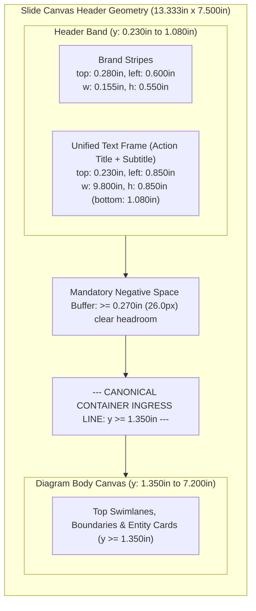

# Feature Specification: DeckHeaderContract & Multi-Slide Header Consistency Linter (`DECK_HEADER_DRIFT`)

> **Repository:** `enterprise-bench` | **Subsystem:** Diagram Engine V2 (`src/ppt_engine/diagram_v2/`)  
> **Status:** Architecture Designed • Backlog Queued  
> **Target Files:** [`auditor.py`](../../src/ppt_engine/diagram_v2/auditor.py), [`models.py`](../../src/ppt_engine/diagram_v2/models.py), [`pptx_compiler.py`](../../src/ppt_engine/diagram_v2/pptx_compiler.py), [`svg_compiler.py`](../../src/ppt_engine/diagram_v2/svg_compiler.py), [`drawio_compiler.py`](../../src/ppt_engine/diagram_v2/drawio_compiler.py), [`stray_consolidator.py`](../../src/ppt_engine/diagram_v2/stray_consolidator.py)

---

## 1. Problem Statement & Empirical Defect Evidence

In multi-slide consulting deliverables, theme bundles (`output/bundles/LATEST_*_visuals.pptx`), and presentation decks (e.g. `cdsw_whitelist_system_design_expanded_visualization.pptx`), slide headers across sequential diagram slides exhibit visible coordinate drift, visual flipbook jank, and severe vertical clearance squeeze due to four systemic causes:

1. **Unsynchronized Default Header Coordinates (`hy = 0.40` vs. `0.28`):**
   In [`pptx_compiler.py`](../../src/ppt_engine/diagram_v2/pptx_compiler.py), `_compile_header()` defaulted `hy = h.y if h.y is not None else 0.40`. Meanwhile, manually polished single-slide specifications such as [`specs/diagrams/cdsw_expanded.yaml`](../../specs/diagrams/cdsw_expanded.yaml) and [`specs/diagrams/proposed_aws_lambda_expanded.yaml`](../../specs/diagrams/proposed_aws_lambda_expanded.yaml) explicitly set `header.y: 0.28`. When specs without an explicit `y` override (such as [`specs/diagrams/databricks_jobs_api.yaml`](../../specs/diagrams/databricks_jobs_api.yaml)) are compiled into the same deck, Slide 1 places brand stripes at $y = 0.280''$ and action title at $y = 0.230''$, whereas Slide 2 drops them to $y = 0.400''$ and $y = 0.350''$—causing an abrupt $0.120''$ (11.5pt) downward bounce when flipping slides.
2. **Header-to-Container Headroom Squeeze ($0.10''$ vs. $\ge 0.25''$ Mandate):**
   In Slide 2, the action title/subtitle text box is positioned at `top = 0.350in` with height `0.850in`, causing the bounding box of the header frame to terminate at $y = 0.350 + 0.850 = 1.200''$. Because container swimlanes across legacy templates are anchored at $y = 1.300''$ (e.g. `group_user` in `cdsw_expanded.yaml`), the vertical clearance buffer between the subtitle baseline and the container ceiling is crushed to an unacceptable $0.100''$ (9.6px). This produces acute visual crowding, especially when subtitles wrap across two full lines.
3. **Outdated Single-Slide Auditor Margin Heuristic:**
   [`Tier1GeometricLinter.check_ceiling_and_header_clearance()`](../../src/ppt_engine/diagram_v2/auditor.py) historically verified header clearance using a loose static threshold (`header_bottom = 85.0px`, equivalent to $\approx 0.885''$). This blind spot allowed nodes and containers starting at $y = 1.00''\text{--}1.30''$ to pass linting even while physically encroaching into the action subtitle's required breathing buffer.
4. **Isolated Multi-Slide Bundle Compilations:**
   When [`stray_consolidator.py`](../../src/ppt_engine/diagram_v2/stray_consolidator.py) merges disparate YAML specifications into unified theme decks, it lacks a multi-slide coherence gate. As a result, individual diagram slides retain varying header placements, font weights, and vertical ingress points across what is meant to be a coherent consulting narrative.

---

## 2. Architectural Design

### 2.1 The Canonical `DeckHeaderContract` Standard

All slide header geometry across single-slide compilers and multi-slide deck bundles is unified under an immutable geometric contract, codifying the standard established in [`docs/specs/powerpoint_slide_geometry.md`](../specs/powerpoint_slide_geometry.md):

| Component | Invariant Property | Coordinate / Dimension (Inches) | Dimension (96 DPI Pixels) | Design Intent & Visual Rationale |
| :--- | :--- | :---: | :---: | :--- |
| **Brand Stripe: Red** | `top`, `left`, `w`, `h` | `(0.280, 0.600, 0.045, 0.550)` | `(26.88, 57.60, 4.32, 52.80)` | 1-unit crimson brand accent stripe (`#E11D48`). |
| **Brand Stripe: Blue** | `top`, `left`, `w`, `h` | `(0.280, 0.665, 0.090, 0.550)` | `(26.88, 63.84, 8.64, 52.80)` | 2-unit metrodata blue accent stripe (`#0284C7`), exact 1:2 ratio. |
| **Unified Title Frame** | `top`, `left`, `w`, `h` | `(0.230, 0.850, 9.800, 0.850)` | `(22.08, 81.60, 940.80, 81.60)` | Top aligned at $y=0.230''$ to align 20pt font cap-height with stripe top. |
| **Unified Title Frame (No Stripes)** | `top`, `left`, `w`, `h` | `(0.230, 0.600, 10.050, 0.850)` | `(22.08, 57.60, 964.80, 81.60)` | Flush left alignment when `brand_stripes: false`. |
| **Action Title Typography** | Font, Size, Weight, Color | Arial, `20.0 pt`, Bold, `#0F172A` | — | High-contrast narrative takeaway headline. |
| **Subtitle Typography** | Font, Size, Offset, Color | Arial, `11.0 pt`, Regular, `#64748B` | — | Space before = `Pt(4)` inside identical unified text frame. |
| **Canonical Container Ingress Line** | `min_container_y` | `1.350 in` | `129.60 px` | **Guarantees $\ge 0.270''$ ($26\text{px}$) clear headroom** below title box. |



### 2.2 Canonical Container Ingress Line Invariant (`y >= 1.350in`)

To permanently eliminate headroom starvation between narrative subtitles and diagram boundaries:
1. **The Ingress Boundary:** The topmost coordinate of any container (`ContainerSpec.y`), zone boundary, or root entity card (`NodeSpec.y`) must satisfy $y \ge 1.350''$ ($129.6\text{px}$).
2. **Guaranteed Clearance Budget:** With the title frame anchored at $y = 0.230''$ and bounded by $h = 0.850''$, the bottom of the title box is strictly $y = 1.080''$. The canonical ingress line guarantees a buffer:
   $$\Delta y = 1.350'' - 1.080'' = 0.270'' \quad (25.92\text{ px} \approx 19.4\text{ pt})$$
   This satisfies the consulting standard requiring at least $0.250''$ of unencumbered negative space, preventing visual crowding even when subtitles wrap across two full lines.

### 2.3 Check #15: `DECK_HEADER_DRIFT` in `Tier1GeometricLinter` & Multi-Slide Bundle Validator

The audit suite is expanded with Check #15, deployed across both single-diagram validation and multi-slide deck compilation:

#### 15a. Single-Spec Geometric Compliance (`Tier1GeometricLinter` in [`auditor.py`](../../src/ppt_engine/diagram_v2/auditor.py))
- **Header Placement Drift:** When `header.show` is True, verify that `header.y` equals `0.280in` ($\pm 0.010''$ tolerance). Any manual override deviating from standard (e.g. `y: 0.40`) raises a `WARNING` (or `CRITICAL` under `--strict`).
- **Container Ingress Breach:** Flags any container or node whose top edge violates the canonical ingress line ($y < 1.350''$). Emits category `CANVAS_HEADER_OCCLUSION` with a concrete recommendation to lower the component to $y \ge 1.350''$.
- **Effective Subtitle Headroom Buffer:** Calculates the physical distance between the resolved bottom of the header box and the highest diagram element:
  $$\text{Clearance} = \min_{c \in \text{containers}, n \in \text{nodes}}(c.y, n.y) - 1.080''$$
  If $\text{Clearance} < 0.250''$, emits `HEADER_HEADROOM_INSUFFICIENT`.

#### 15b. Multi-Slide Deck Header Consistency (`BundleValidator` in [`stray_consolidator.py`](../../src/ppt_engine/diagram_v2/stray_consolidator.py))
- When compiling multi-slide presentations or validating clusters in `output/bundles/`, extracts the header coordinates of all constituent slides:
  - $\Delta y_{\text{stripes}} = \max(y_{\text{stripes}}) - \min(y_{\text{stripes}})$
  - $\Delta y_{\text{title}} = \max(y_{\text{title}}) - \min(y_{\text{title}})$
  - $\Delta x_{\text{title}} = \max(x_{\text{title}}) - \min(x_{\text{title}})$
- **Zero-Tolerance Invariant:** If $\Delta y_{\text{stripes}} > 0.005''$ or $\Delta y_{\text{title}} > 0.005''$ across slides in the same deck, emits `DECK_HEADER_DRIFT` (`CRITICAL`), halting stage-gate approval until all slides conform to `DeckHeaderContract`.

### 2.4 Cross-Compiler Default Alignment

1. **`models.py` (`HeaderConfig`):**
   Update default values to match the standard contract directly:
   ```python
   class HeaderConfig(BaseModel):
       show: bool = True
       action_title: str = "Proposed: Enterprise Architecture"
       subtitle: str = "System Architecture & Execution Lifecycle Dataflow"
       tracker: Optional[str] = None
       brand_stripes: bool = True
       stripe_ratio: str = "1:2"
       red_hex: str = "#E11D48"
       blue_hex: str = "#0284C7"
       x: float = 0.600
       y: float = 0.280
   ```
2. **`pptx_compiler.py`:**
   Replace the hardcoded fallback `hy = h.y if h.y is not None else 0.40` with `DeckHeaderContract.STRIPES_TOP_IN` (`0.280in`) and `DeckHeaderContract.TITLE_TOP_IN` (`0.230in`).
3. **`svg_compiler.py` & `drawio_compiler.py`:**
   Align header rendering logic and viewBox offsets to `0.280in` ($26.88\text{px}$) and `0.230in` ($22.08\text{px}$) so SVG and Draw.io previews maintain exact spatial alignment with native PowerPoint slide geometry.

---

## 3. System Guardrails (Preventing Negative Side Effects)

1. **Zero Impact on Headless Diagram Audits:**
   Diagrams with `header.show: false` (e.g. standalone sub-architectures or modular visual components intended for document inclusion) completely bypass header alignment checks without emitting false-positive warnings.
2. **Preserve Bidirectional Reconciler Determinism:**
   `PPTXDiagramDecompiler` and `DiagramReconciler` rely on shape naming conventions (`header:stripe:red`, `header:stripe:blue`, `header:title`). Standardizing the coordinates locks these shape names into fixed coordinate anchors, preventing false drift detections during `bench diagram v2 reconcile`.
3. **Unified Single-Frame Text Flow:**
   Action Title and Subtitle remain strictly within a **single text frame** (`space_before = Pt(4)`). Compilers must never split them into two separate floating text frames, ensuring that titles with dynamic lengths never collide with the subtitle.

---

## 4. Implementation Checklist

- [ ] Define `DeckHeaderContract` with physical coordinate constants in [`src/ppt_engine/diagram_v2/models.py`](../../src/ppt_engine/diagram_v2/models.py).
- [ ] Update `HeaderConfig` in [`models.py`](../../src/ppt_engine/diagram_v2/models.py) to default `x = 0.600` and `y = 0.280`.
- [ ] Refactor `_compile_header` in [`src/ppt_engine/diagram_v2/pptx_compiler.py`](../../src/ppt_engine/diagram_v2/pptx_compiler.py) to reference `DeckHeaderContract` coordinates (`top = 0.280in` for stripes, `top = 0.230in` for title box).
- [ ] Synchronize SVG and Draw.io compilers ([`svg_compiler.py`](../../src/ppt_engine/diagram_v2/svg_compiler.py), [`drawio_compiler.py`](../../src/ppt_engine/diagram_v2/drawio_compiler.py)) with `DeckHeaderContract` pixel dimensions.
- [ ] Implement Check #15 (`DECK_HEADER_DRIFT` and `CANVAS_HEADER_OCCLUSION` with `min_y = 1.350in`) in `Tier1GeometricLinter` ([`src/ppt_engine/diagram_v2/auditor.py`](../../src/ppt_engine/diagram_v2/auditor.py)).
- [ ] Implement multi-slide deck header consistency verification in [`src/ppt_engine/diagram_v2/stray_consolidator.py`](../../src/ppt_engine/diagram_v2/stray_consolidator.py).
- [ ] Normalize existing YAML specifications ([`cdsw_expanded.yaml`](../../specs/diagrams/cdsw_expanded.yaml), [`databricks_jobs_api.yaml`](../../specs/diagrams/databricks_jobs_api.yaml), [`proposed_aws_lambda_expanded.yaml`](../../specs/diagrams/proposed_aws_lambda_expanded.yaml)) to align top containers with $y \ge 1.350''$.
- [ ] Update index registration in [`docs/INDEX.md`](../INDEX.md).

---

## 5. Verification & Preflight Procedures

1. **Single-Slide Headless Geometric Audit:**
   Execute headless Tier 1 verification across individual diagrams to confirm zero header occlusion and strict adherence to the $y \ge 1.350''$ ingress line:
   ```bash
   uv run bench diagram v2 audit specs/diagrams/cdsw_expanded.yaml --strict
   uv run bench diagram v2 audit specs/diagrams/databricks_jobs_api.yaml --strict
   ```
2. **Multi-Slide Deck Bundle Audit:**
   Audit all diagrams within a bundle cluster to ensure inter-slide header stability:
   ```bash
   uv run bench diagram v2 audit specs/diagrams/ --strict
   ```
3. **Compilation & Headless Visual QA:**
   Compile the unified presentation deck and verify DrawingML coordinates headlessly:
   ```bash
   uv run bench diagram v2 compile specs/diagrams/cdsw_expanded.yaml --format pptx
   uv run bench diagram v2 visual-qa specs/diagrams/cdsw_expanded.yaml --tier 1
   ```
