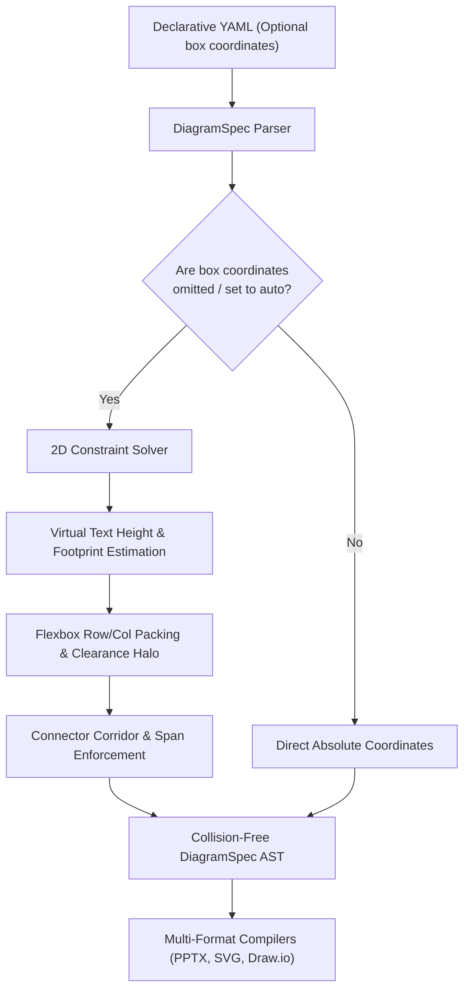

# Feature Specification: 2D Constraint & Flexbox Auto-Layout Solver

> **Document ID:** `SPEC-BACKLOG-DIAGRAM-V2-AUTO-LAYOUT`  
> **Repository:** `enterprise-bench` | **Subsystem:** Diagram Engine V2 (`src/ppt_engine/diagram_v2/`)  
> **Status:** Backlog Queued • Architecture Formulated  
> **Target Files:** `src/ppt_engine/diagram_v2/layout_solver.py`, `models.py`, `cli/diagram_v2.py`  

---

## 1. Problem Statement

Authoring declarative diagram YAML specifications currently mandates hardcoded absolute coordinates (`box: [x, y, w, h]`). This forces repetitive manual trial-and-error:
1. Text wrapping adjustments alter required card heights, causing boundary overflow.
2. Sibling nodes collide or violate the $\ge 14\text{pt}$ clearance halo.
3. Connector spans fail the minimum corridor span invariant ($L \ge W_{\text{pill}} + 2 \times \text{Halo}$).
4. Up to 40% of conversational turns and prompt tokens are consumed diagnosing and adjusting coordinate integers.

---

## 2. Target Architecture



### 2.1 Declarative Syntax
Support optional layout directives inside containers:
```yaml
containers:
  - id: ingestion_tier
    layout: horizontal    # horizontal | vertical | grid
    gap: 20               # spacing between child nodes in pt
    padding: 16
    align: center
nodes:
  - id: kafka_broker
    container: ingestion_tier
    # box omitted -> dynamically sized & positioned by solver
```

### 2.2 Execution Pipeline
1. Compute node dimensions based on title, subtitle, bullets, and icon layout.
2. Apply container padding and arrange nodes along the specified flex axis.
3. Guarantee minimum connector corridor spans and port clearance before compilation.
