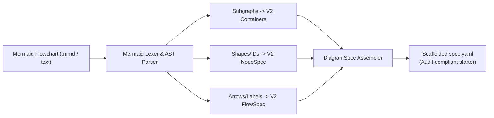

# Feature Specification: Mermaid-to-YAML AST Transpiler

> **Document ID:** `SPEC-BACKLOG-DIAGRAM-V2-MERMAID-TRANSPILER`  
> **Repository:** `enterprise-bench` | **Subsystem:** Diagram Engine V2 (`src/ppt_engine/diagram_v2/`)  
> **Status:** Backlog Queued • Architecture Formulated  
> **Target Files:** `src/ppt_engine/diagram_v2/mermaid_transpiler.py`, `src/cli/diagram_v2.py`  

---

## 1. Problem Statement

In V1 (`bench diagram add --mermaid`), users could generate Draw.io diagram pages directly from Mermaid flowchart syntax. In Diagram Engine V2, this pipeline was decoupled, requiring 100% manual authoring of verbose YAML topologies (`specs/diagrams/<name>.yaml`). Translating simple whiteboard sketches or architectural flowcharts into V2 YAML requires high LLM token consumption and unnecessary cognitive friction.

---

## 2. Target Architecture



### 2.1 CLI Interface
```bash
uv run bench diagram v2 ingest --mermaid input.mmd --output specs/diagrams/generated.yaml
```

### 2.2 Semantic Mapping Rules
- `subgraph Tier ["Title"]` $\implies$ `containers` with title, default `#F8FAFC` fill, and `#94A3B8` border.
- `A[/"Label"/]` / `[(DB)]` $\implies$ `shape_type: cylinder` or standard rectangle cards.
- Edge text `-->|protocol|` $\implies$ `flows` label with standard high-contrast pill styling.
- Auto-assign default enterprise diagnostic palette (`#0284C7` for active flows, `#16A34A` for targets).
