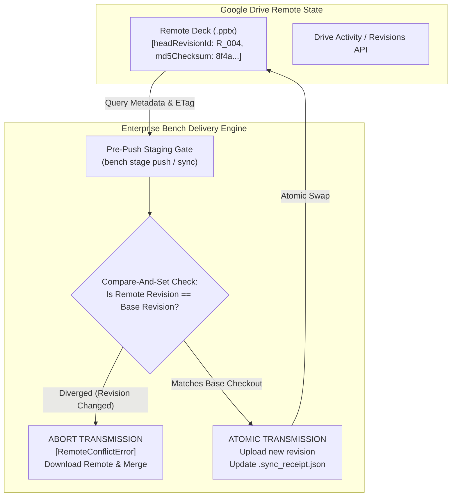

# Architecture Spec — Remote Cloud Drift & Multi-Agent Race Condition Guard

> **Document ID:** `SPEC-BACKLOG-REMOTE-RACE-GUARD`  
> **Status:** Backlog Queued • Architecture Formulated  
> **Target Subsystem:** `enterprise-bench/src/core/delivery/` & `scripts/delivery_pipeline.py`  
> **Related Standards:** [`docs/specs/lifecycle_architecture.md`](../specs/lifecycle_architecture.md), [`docs/specs/pptx_file_watcher_and_geometric_reconciliation.md`](../specs/pptx_file_watcher_and_geometric_reconciliation.md)

---

## 1. Executive Summary & Problem Statement

In distributed consulting engagements, deliverable decks (`.pptx`) and architecture diagrams live in a hybrid state between local agent environments and shared team drives (Google Drive). Two unmitigated operational failure modes currently introduce data loss and silent regression:

1. **Silent Remote Drift (Out-of-Band Manual Edits):** Human collaborators edit slides directly on Google Drive (via Google Slides or desktop Office re-saves) without updating local metadata. The local agent/pipeline has no awareness of remote revision increments or hash divergence, risking silent clobbering on the next local push.
2. **Bi-Directional Agent/Human Race Conditions:** A teammate downloads a deck from Drive to edit locally. Simultaneously, an agent generates new slides and pushes them to Drive. When the teammate re-uploads their revised version, the agent's updates are wiped out with zero conflict warning.

---

## 2. Threat Vector & Failure Matrix

| Threat ID | Execution Vector | Immediate Failure Mode | Root Cause in Current Architecture |
| :--- | :--- | :--- | :--- |
| **TV-01: Silent Remote Edit** | Human edits deck on Google Drive / Google Slides. | Agent runs `bench stage push` or `upload` and overwrites human edits with local state. | Push mechanism only verifies local-to-local differential hash against mount path without polling remote Drive revision history or ETag. |
| **TV-02: Simultaneous Checkout Race** | Teammate A downloads deck; Agent B initiates compilation and pushes revision. Teammate A uploads finished deck. | Agent B's newly compiled vector slides are lost (blind overwrite). | Lack of distributed Optimistic Concurrency Control (OCC) / Check-And-Set (CAS) token tied to remote Drive `headRevisionId`. |
| **TV-03: Desynchronized Slide Extraction** | Human modifies text/labels on Slide 2; Agent compiles net-new Slide 5. | Merging them requires full-deck geometric reconciliation rather than atomic slide-level merging. | Slide updates are monolithic at the `.pptx` container level rather than decomposed into modular per-slide vector manifests. |

---

## 3. Target Architecture & Defense-in-Depth Protocol



### 3.1. Remote Revision Pinning & Optimistic Concurrency Control (OCC)
* **Base Checkout Token:** When checking out or downloading a file from Drive (`gdrive readonly download` or `bench stage checkout --remote`), capture and record remote metadata in `.sync_receipt.json`:
  ```json
  {
    "file_id": "1puD8NVpsWp_2-71EW5x1tQJPTU2yfyoB",
    "base_revision_id": "142857",
    "base_md5": "a3f5c9e2b104...",
    "base_modified_time": "2026-10-19T03:32:28.000Z",
    "checkout_user": "marcelljw"
  }
  ```
* **CAS (Compare-And-Set) Validation on Push:** Before pushing local changes, `bench stage push` queries Google Drive API / `gdrive readonly info <file_id>`:
  - If remote `headRevisionId != base_revision_id` OR `md5Checksum != base_md5`, transmission is immediately **blocked with exit code 2 (`RemoteConflictError`)**.
  - A three-way merge prompt is surfaced: download remote copy as `_REMOTE_<timestamp>.pptx`, invoke visual differ / slide watcher, and prompt user.

### 3.2. Remote Lock Sidecars on Google Drive
* To protect human teammates from accidental agent overwrites while human editing is active:
  - When checking out a file for active work, stamp a remote sidecar lock file in the same Drive folder: `._LOCKED_<username>_<timestamp>.json`.
  - Any agent or script attempting to push to that folder must inspect sibling files; if a lock file from another user exists and is younger than TTL (e.g., 2 hours), push is refused.

### 3.3. Out-of-Band Manual Edit Polling (Drift Detection)
* Extend `bench diagram v2 watch` and `bench stage preflight` with a `--remote-drift` flag:
  - Checks remote Drive files against local cache timestamps.
  - Alerts the operator: `⚠️ Remote file has been modified on Google Drive by [user@domain.com] at [time]. Local copy is stale.`

---

## 4. Implementation Phasing & CLI Commands

1. **Phase 1: CLI Metadata & Receipt Pinning:**
   - Store `remote_file_id`, `base_revision_id`, and `base_md5` in `doc_output/.sync_receipt.json`.
   - Update `scripts/delivery_pipeline.py` to inspect remote metadata before calling upload.
2. **Phase 2: Remote CAS Guard Enforcement:**
   - Add `--cas / --strict-cas` flag to `bench stage push` and `delivery_pipeline.py stage push`.
   - Implement graceful remote conflict branching (`_REMOTE_BRANCH.pptx`).
3. **Phase 3: Automated Slide-Level 3-Way Reconciliation:**
   - Combine `bench diagram v2 decompile` and `bench diagram v2 compile` to merge diverged slides without clobbering non-overlapping slide numbers.

---

## 5. Verification Gate & Acceptance Criteria

* [ ] `bench stage push` fails fast and generates `RemoteConflictError` if remote file was updated out-of-band.
* [ ] Atomic upload only succeeds when remote revision strictly matches recorded checkout state.
* [ ] Human-readable conflict report detailing remote modifying user and timestamp.
