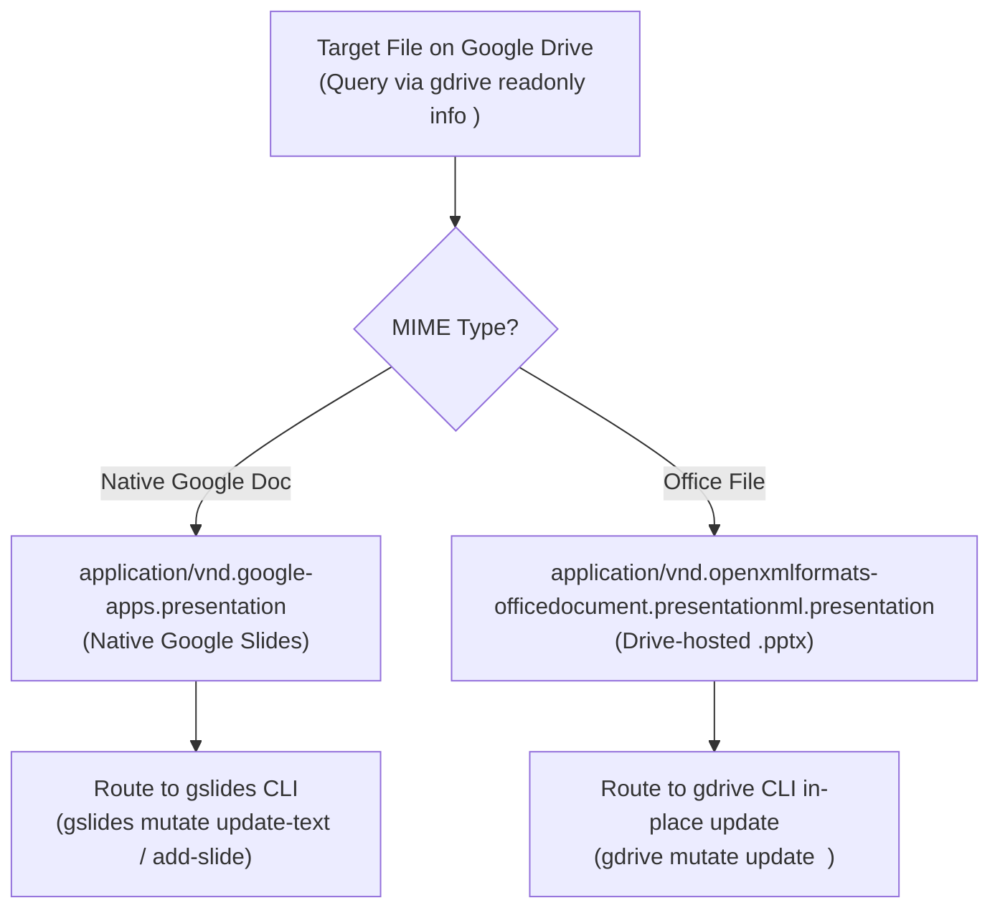

# Architectural Specification — Google Drive & Slides Multi-Agent Collaboration Protocol

> **Document ID:** `SPEC-CLOUD-DRIVE-COLLABORATION`  
> **Status:** Enduring Architecture Standard  
> **Target Subsystems:** `gdrive` CLI, `gslides` CLI, `src/core/delivery/`, `scripts/delivery_pipeline.py`  
> **Related Standards:** [`docs/specs/lifecycle_architecture.md`](lifecycle_architecture.md), [`docs/specs/powerpoint_slide_geometry.md`](powerpoint_slide_geometry.md), [`docs/backlog/remote_cloud_drift_and_race_condition_guard.md`](../backlog/remote_cloud_drift_and_race_condition_guard.md)

---

## 1. Executive Summary & Problem Statement

In enterprise IT engagements, consulting presentations live concurrently across local engineering repositories and cloud collaboration environments (Google Drive / Google Slides). When multiple autonomous agents and human consultants edit deliverables in parallel, three critical operational failure modes emerge:

1. **API Precondition Failure (Office `.pptx` vs. Native Google Slides):**  
   Google Drive renders `.pptx` presentations in the browser under `https://docs.google.com/presentation/d/<id>/edit`. However, the Google Slides REST API (`gslides` CLI) strictly rejects Office files with:  
   `googleapi: Error 400: This operation is not supported for this document. The document must not be an Office file., failedPrecondition`.  
   Targeting `.pptx` files with `gslides mutate` causes immediate script failure and blocked deployment.

2. **Slide Order Shifting (The Numeric Indexing Anti-Pattern):**  
   Parallel agents and human contributors frequently insert, delete, or rearrange slides (e.g. inserting an interim `DRAFT` cover at Slide 6 pushes an architecture diagram to Slide 7). Hardcoded slide indices (`prs.slides[5]`, `slideIndex = 6`) result in silent corruption, overwriting incorrect slides, or clobbering collaborator work.

3. **Silent Cloud Drift & Blind Overwrite:**  
   Pushing local changes without verifying remote `headRevisionId` or `md5Checksum` silently obliterates out-of-band slide edits authored by teammates on Google Drive.

---

## 2. Mandatory Operational Invariants

### 🏛 Invariant 1: Format-Aware API Routing (The Precondition Gate)

Deliverable modifications must strictly route by the cloud file's underlying MIME type:



* **Native Google Slides:** Use `gslides mutate ...` / `gslides readonly ...` for element-level mutations.
* **Office `.pptx` on Drive:** Edit and compile locally using Diagram Engine V2 (`uv run bench diagram v2 compile`), then synchronize in-place via:
  ```bash
  gdrive mutate update <FILE_ID> <LOCAL_PATH.pptx>
  ```
  *Note:* `gdrive mutate update` preserves the Drive File ID, web link, permissions, and revision history. Never use `gdrive mutate upload` to replace an existing document, as it generates orphaned duplicate IDs.

---

### 📐 Invariant 2: Dynamic Title-Based Slide Indexing (Anti-Hardcoding Gate)

Agents and automated scripts must **never** reference slides by static integer indices in multi-slide decks. Every slide mutation must resolve its target dynamically:

1. **Inspection Gate:** Iterate through presentation slides and match the canonical `action_title`, header kicker, or specific shape object name:
   ```python
   def find_slide_by_title(prs: Presentation, title_fragment: str) -> Tuple[int, Slide]:
       for idx, slide in enumerate(prs.slides):
           for shape in slide.shapes:
               if shape.has_text_frame and title_fragment.lower() in shape.text.lower():
                   return idx, slide
       raise ValueError(f"Slide containing '{title_fragment}' not found in presentation.")
   ```
2. **Order Shift Awareness:** When performing slide insertion, verify preceding and trailing slide titles to ensure index shifts do not disrupt adjoining presentation flow.

---

### 🛡 Invariant 3: Remote Optimistic Concurrency Control (OCC)

Prior to updating cloud deliverables:

1. **Receipt Pinning:** Track remote metadata in `.sync_receipt.json` upon checkout:
   ```json
   {
     "file_id": "1uDYO91tYHl7YwMJngToe7BZtO8LpXiyz",
     "base_revision_id": "184",
     "base_md5": "b3e1a04f...",
     "base_modified_time": "2026-10-19T04:01:05.000Z"
   }
   ```
2. **Pre-Push CAS Verification:** Query remote metadata via `gdrive readonly info <file_id> --json`. If the remote `modifiedTime` or revision diverges from base checkout, inspect recent changes before pushing to prevent clobbering parallel contributions.
3. **Round-Trip Verification Gate:** Following `gdrive mutate update`, perform a headless verification download to verify total slide count, XML schema integrity, and element text.

---

## 3. Standard Operational CLI Commands

```bash
# 1. Inspect remote file metadata and MIME type
gdrive readonly info <FILE_ID> --json

# 2. Update cloud Office .pptx deliverable in-place
gdrive mutate update <FILE_ID> <path/to/updated_deck.pptx>

# 3. Headless round-trip download verification
gdrive readonly download <FILE_ID> -o /tmp/verify_remote.pptx

# 4. Native Google Slides element-level text update
gslides mutate update-text <PRESENTATION_ID> --element <ELEMENT_ID> --text "Updated Label"
```
